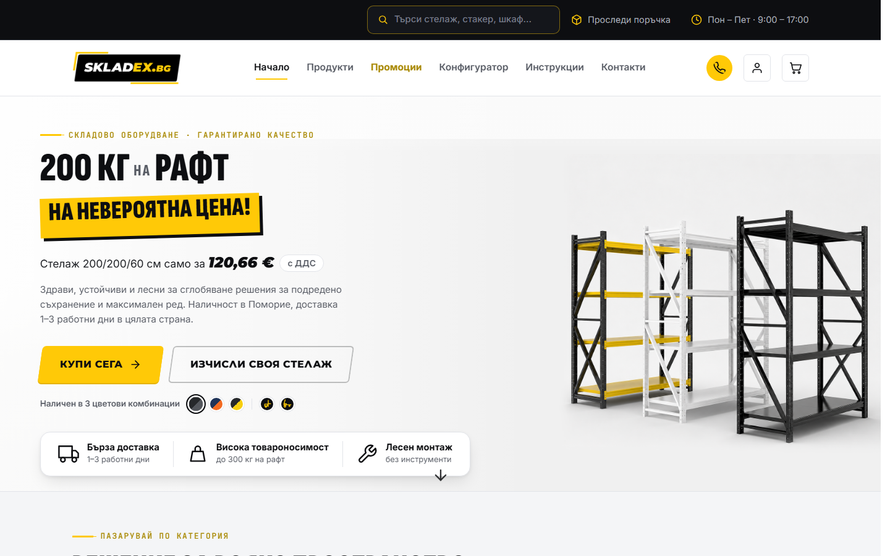
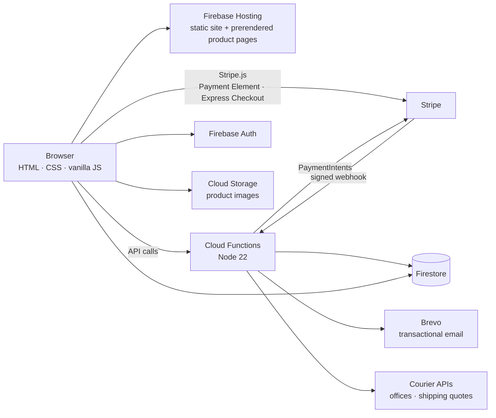
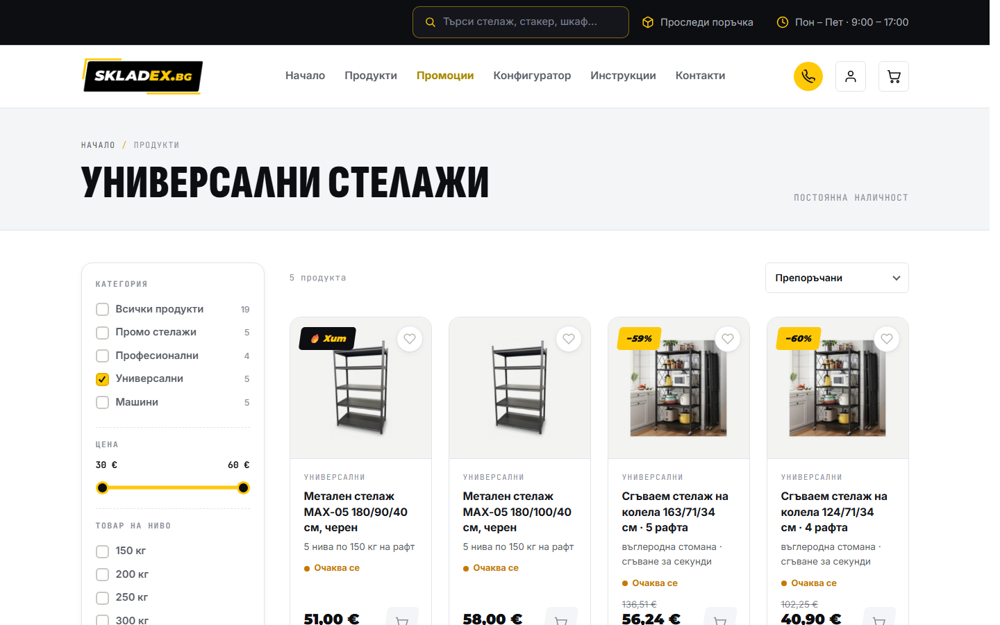
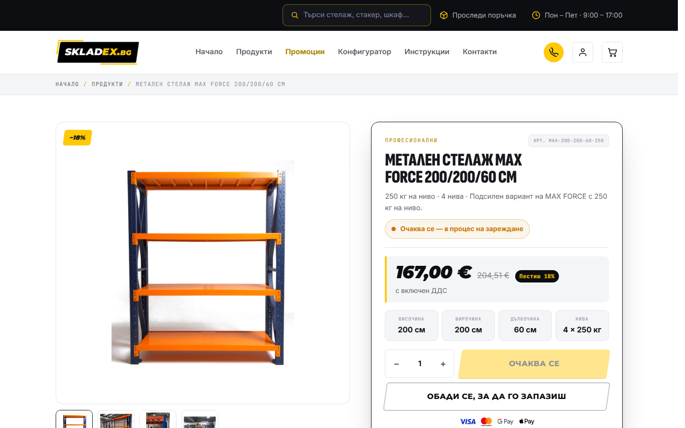
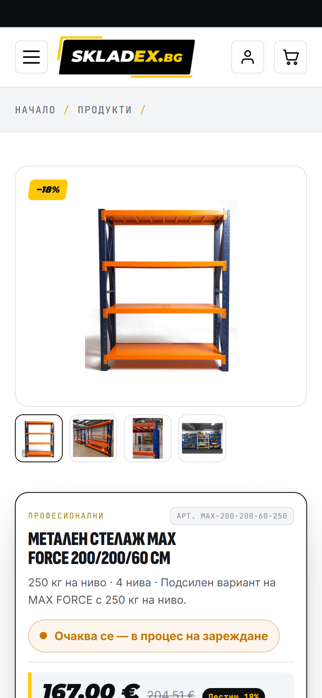
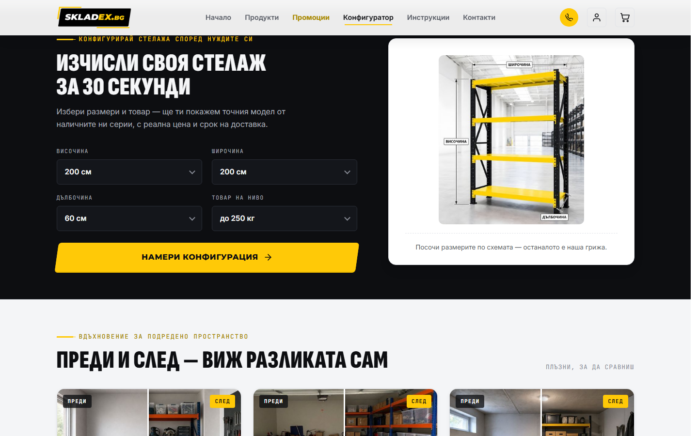
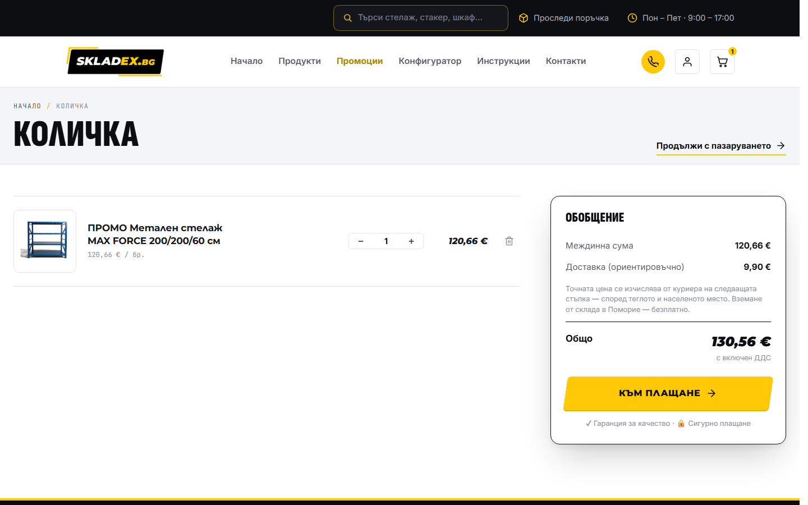
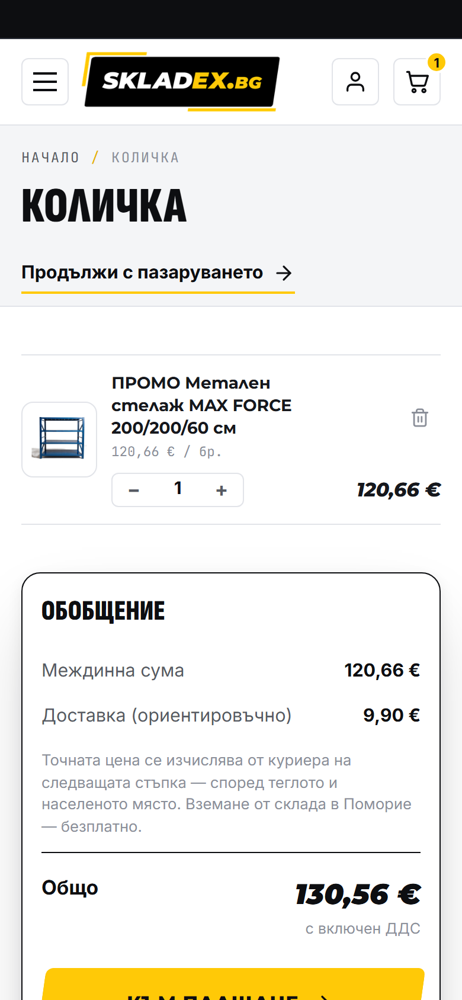

# skladex.bg — e-commerce store

**A production online store for metal shelving and warehouse machines, built from scratch without a framework.**

> **Client project.** This repo is a public case study; the source is private.
> Code walkthrough available to recruiters on request: kevinrusev1@gmail.com or [LinkedIn](https://www.linkedin.com/in/kevin-rusev).

## What it is

skladex.bg is the online store of a Bulgarian importer of metal shelving and warehouse
equipment (shelving units, pallet trucks, stackers). It is live and taking real orders:
customers browse the catalogue, configure a shelf, pay by card, Google Pay / Apple Pay,
cash on delivery or bank transfer, and track the order until it is delivered.

The site is in Bulgarian and priced in euro. The shop owner runs everything (products, stock,
prices, page text, orders) from an admin panel and an inline editor, without a developer.

## Feature highlights

**Shopping**
- Catalogue with live stock states (in stock, sold out, expected) driven from the database,
  plus category filters, price and load filters, sorting and search.
- Shelf configurator: pick height, width, depth and load per shelf and get the matching model
  with its real price and delivery time, or the closest alternatives.
- Product pages with gallery, spec grid, video instructions, "frequently bought together" and
  similar products.
- Cart with an estimated shipping cost, promo codes and a wishlist.

**Checkout and payments**
- Card payments with an **embedded Stripe checkout** (Payment Element) on the store's own page.
- **Google Pay / Apple Pay** through the Express Checkout Element, right in the order summary.
- Both run on **PaymentIntents**. Stripe's hosted Checkout is kept only as an automatic fallback.
- Cash on delivery and bank transfer (payment details shown right after the order).
- Live courier integration: office lists and shipping quotes from two Bulgarian couriers,
  with an office-picker map.

**After the order**
- Order tracking page with a progress timeline and a "pay now" option for unpaid card orders.
- Transactional emails: order confirmation, status changes, payment received, sent through Brevo.
- Customer accounts: email/password plus Google, Facebook and Apple sign-in; order history,
  saved addresses, receipts and invoices.
- Online contract-withdrawal form, as required by EU consumer law.

**For the shop owner**
- Admin panel: orders (filters, bulk status changes, shipping labels, invoices, CSV export,
  Stripe fees per order), products (bulk edits, image upload), promo codes, users.
- Inline CMS: page text, images, hero slides and theme colours are edited directly on the
  live page.
- Daily automatic backups of the catalogue and content.

**SEO**
- Prerendered static HTML for every product page, plus a generated sitemap and `llms.txt`, so
  search engines and AI crawlers see full content without running JavaScript.
- Structured data (Product, BreadcrumbList, Organization / LocalBusiness, FAQ) and
  long-cache static assets.

## Architecture

The site is plain static files on Firebase Hosting: no framework and no bundler. Catalogue,
content and orders live in Firestore. Anything that touches money, stock or third-party
credentials runs in Cloud Functions: pricing, payment intents, the Stripe webhook, courier
calls and emails.

More detail, including the payment flow, is in [docs/architecture.md](docs/architecture.md).

## Tech stack

- **Frontend:** HTML, CSS, vanilla JavaScript (no framework, no build step for the site itself)
- **Hosting:** Firebase Hosting
- **Backend:** Cloud Functions for Firebase (2nd gen, Node 22): HTTP API, Firestore triggers,
  scheduled jobs
- **Data:** Cloud Firestore, Cloud Storage, Firebase Authentication
- **Payments:** Stripe (Payment Element, Express Checkout Element, PaymentIntents, webhooks)
- **Email:** Brevo transactional email
- **Shipping:** courier APIs for offices, cities and live shipping quotes
- **Tooling:** Node build scripts for prerendering, the sitemap and image crops

## What I built

I took the project end to end, working directly with the client:

- **Design:** the visual identity on the web, page layouts and the mobile-first UI,
  iterated with the shop owner screen by screen.
- **Build:** the whole storefront, checkout, accounts, admin panel and inline CMS, plus the
  backend (pricing, payments, webhook, couriers, emails, backups).
- **Deployment:** Firebase setup, secrets management, cache strategy and a rollback-friendly
  deploy workflow.
- **SEO:** prerendered product pages, sitemap, structured data and performance work.

## Challenges & decisions

- **Embedded checkout instead of Stripe's hosted page.** Customers stay on skladex.bg, the card
  form is styled to match the store, and Google Pay / Apple Pay sit right in the order summary.
  The wallet button is shown before an order exists, so the order is created only once the
  customer confirms in the wallet sheet. If the embedded setup is ever unavailable, checkout
  falls back to Stripe's hosted page automatically.
- **Idempotent, defensive webhook.** Every webhook is signature-verified and deduplicated by
  Stripe event ID with an atomic "seen" record. That record is released if processing fails,
  so Stripe's retry still goes through. The paid amount and currency must match the server's
  order total. A payment that arrives on a superseded intent, or after the order was
  cancelled, is flagged for a manual refund instead of being marked paid. Intent creation uses
  idempotency keys and reuses an open intent instead of creating duplicates.
- **The server never trusts client prices.** Every order is re-priced from the catalogue with
  a live courier quote and server-checked promo codes before any money is taken. Unpaid card
  orders are cancelled automatically after a while and their stock is put back.
- **Prerendering a database-driven catalogue for SEO.** Products are edited in the admin, so
  product pages would otherwise be rendered in the browser. A build step generates a static
  HTML page per product, plus the sitemap and `llms.txt`. Hosting serves the static file first
  and falls back to the dynamic template for products added since the last build.

## Screenshots

| | Desktop (1440×900) | Mobile (390×844) |
|---|---|---|
| **Home** |  |  |
| **Category** |  |  |
| **Product** |  |  |
| **Configurator** |  |  |
| **Cart** |  |  |

Screenshots are of the live public site, logged out. Contact details in the top bar are hidden.

## Repository

This repository contains documentation and screenshots only. See [LICENSE](LICENSE).
Brand notes are in [brand/](brand/README.md).
