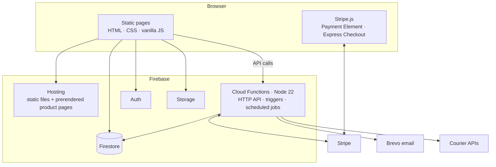
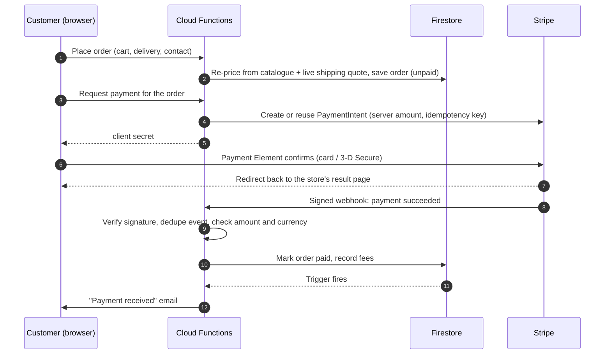

# Architecture

A high-level description of how skladex.bg is put together. No source code, configuration or
credentials are included in this repository.

## Overview

### Frontend

The site is hand-written HTML, CSS and JavaScript with no framework or bundler: what is in the
repository is what gets deployed. A few small scripts share the work: a catalogue/CMS layer, a
store layer (cart, auth, orders), per-page logic, global UI and the admin panel. Static assets
are fingerprinted with a version query and cached for a year. HTML is always revalidated, so a
deploy shows up on the next page load.

The catalogue is read from Firestore at runtime, so stock and price changes made in the admin
appear immediately. Page text, images, hero slides and theme colours can also be edited inline
on the live page by the shop owner. Those overrides are stored separately from the markup.

### Prerendering

Because products live in the database, a build script renders a static HTML page per product
(with metadata and structured data), plus the sitemap and an `llms.txt` summary. Hosting serves
an existing static page first and falls back to the dynamic product template for anything newer,
so a new product is reachable immediately and gets its static page on the next build.

### Backend

Cloud Functions (2nd gen, Node 22, EU region) provide:

- **An HTTP API** for pricing, promo-code checks, payment intents, courier quotes and order
  tracking.
- **A Stripe webhook** that is the single source of truth for "this order is paid".
- **Firestore triggers** that send transactional emails through Brevo on order creation and
  status changes, on new accounts and on withdrawal requests.
- **Scheduled jobs**: daily backups of catalogue and content (keeping a rolling window), and
  clean-up of abandoned unpaid card orders.

Secrets (Stripe, email, courier credentials) live in a managed secret store and are never
shipped to the browser. Only Stripe's publishable key is sent to the client, and only from the
server at runtime.

### Data and access

Firestore holds products, page content, orders, users and promo codes. Security rules make the
public catalogue and content read-only. A customer can read only their own orders, and can
create an order only in an unpaid state with a strictly validated shape. After that, only the
shop owner and the backend can change an order. Payment status is set by the webhook, never by
the browser.

## Payment flow

Card payments and wallets use Stripe **PaymentIntents** with Stripe's embedded UI components,
so the customer never leaves the store.

1. **The order is priced on the server.** The browser sends what the customer chose, not what
   it costs. The backend re-prices every line from the catalogue, adds a live courier quote and
   applies server-validated promo codes. That total is the only amount Stripe will ever charge.
2. **The PaymentIntent is created server-side.** The backend creates a PaymentIntent for that
   exact amount, or reuses the order's existing open intent (updating the amount if the order
   changed). An idempotency key prevents duplicates from double clicks and retries. Only the
   client secret goes back to the browser.
3. **The Payment Element confirms.** Stripe's Payment Element collects the card on the store's
   own page, styled to match it, and handles 3-D Secure. Card data never touches our servers.
4. **The webhook marks the order paid.** The success redirect is only for the customer. The
   order becomes "paid" only when Stripe's signed webhook arrives and passes these checks:
   - the signature is valid;
   - the event has not been processed before (an atomic "seen" record keyed on the event ID,
     released if processing fails so Stripe's retry still works);
   - the intent is the one recorded on the order;
   - the amount and currency match the order total;
   - the order has not been cancelled in the meantime.

   Anything that fails these checks is flagged for a manual refund instead of being silently
   accepted. On success the order is marked paid, the Stripe fee and net amount are recorded for
   accounting, and a Firestore trigger sends the confirmation email.

### Google Pay / Apple Pay

Wallets use Stripe's **Express Checkout Element**, rendered in the order summary next to the
total. It uses a *deferred* intent: the button is shown before any order exists. When the
customer taps it, the form is validated (the click must be answered within a second or Stripe
cancels the sheet). The order is created only after the customer approves in the wallet sheet.
Then the same server-side PaymentIntent and webhook path is used as for cards.

### Other payment methods

- **Cash on delivery:** the order is confirmed immediately and settled with the courier.
- **Bank transfer:** payment details are shown right after the order and emailed. The order is
  marked paid by the shop owner when the transfer arrives.
- **Fallback:** if the embedded checkout cannot start, the backend creates a Stripe hosted
  Checkout session for the same server-priced order. The same webhook settles it.

### Unpaid orders

Card orders that are never paid are cancelled automatically after a while: the open
PaymentIntent is cancelled and the reserved stock is put back. If a payment still lands later,
the webhook flags it for a refund rather than reopening the order.
